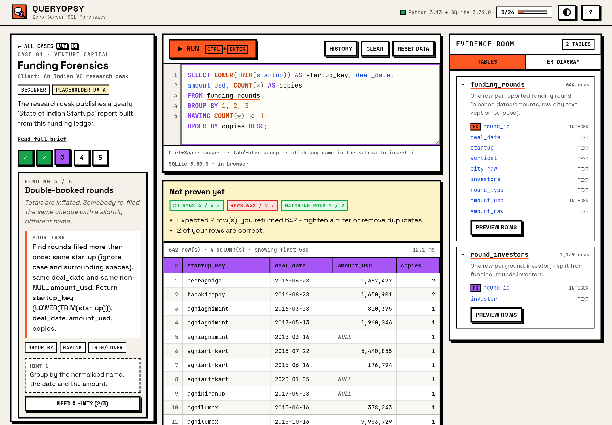
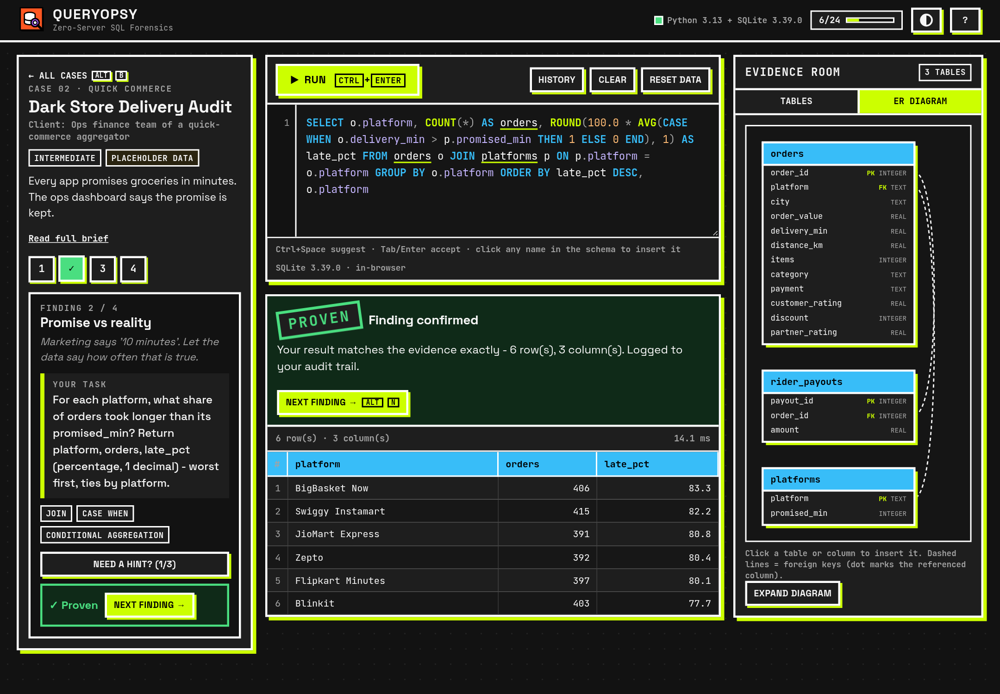
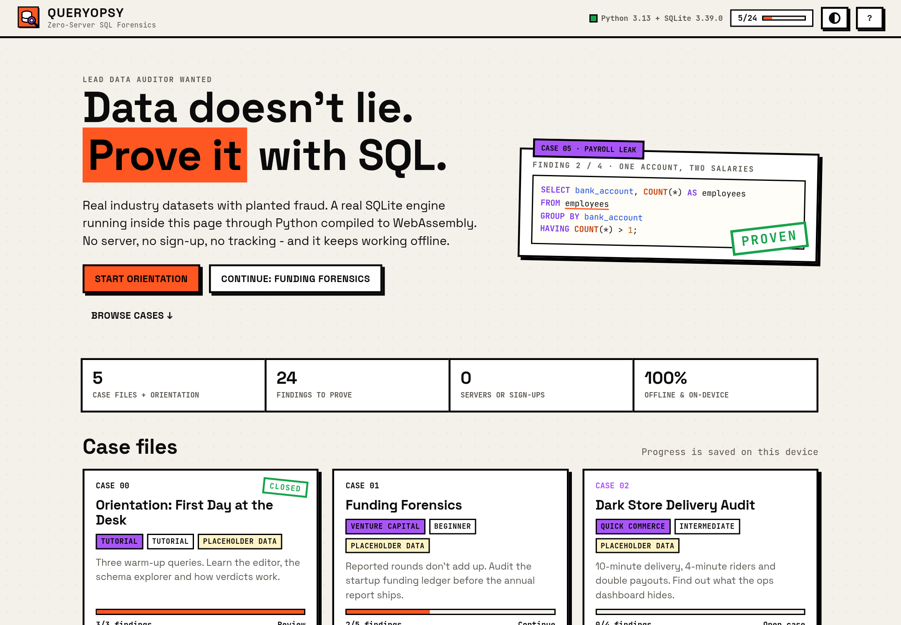
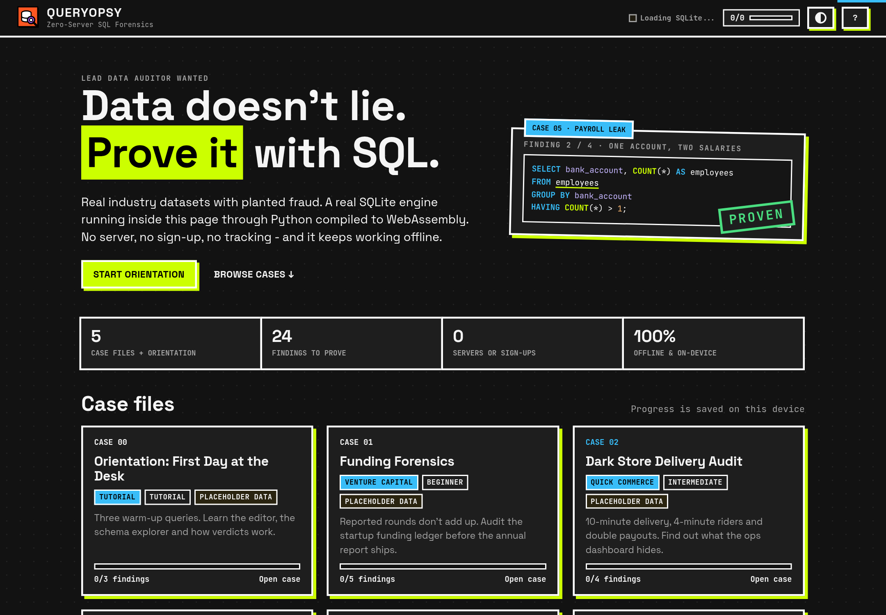
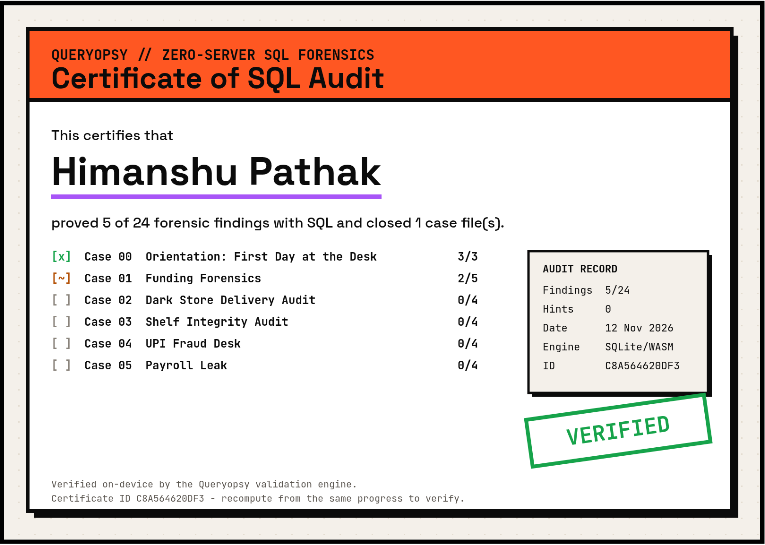
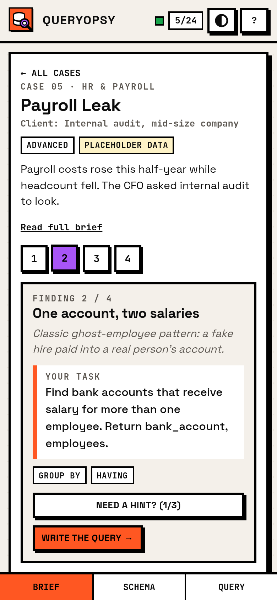
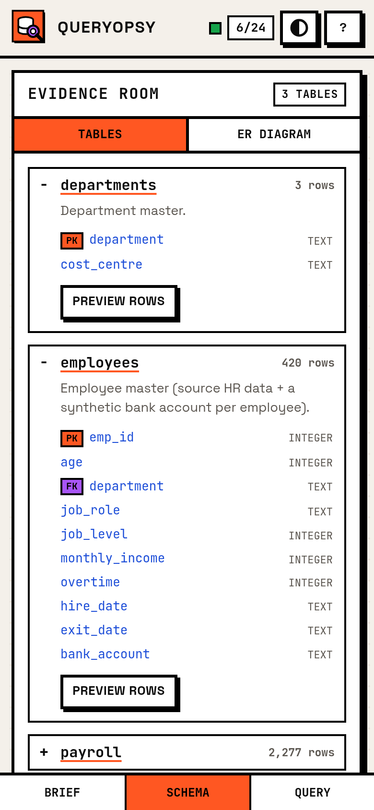
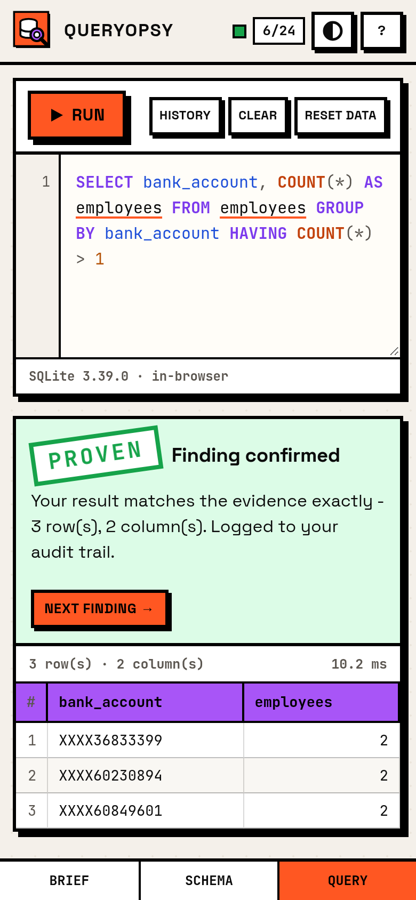
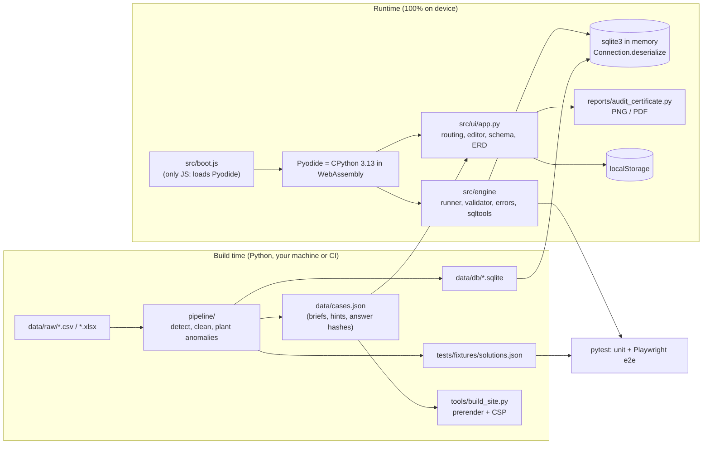

<div align="center">


# Queryopsy

**Zero-server SQL forensics & industry case simulator.**
Audit funding rounds, delivery fleets, shelves, UPI payments and payroll, using real SQL that runs on your own device.

[](https://github.com/Himanshu-5680/queryopsy/actions/workflows/ci.yml)
[](https://github.com/Himanshu-5680/queryopsy/actions/workflows/pages.yml)
[](https://github.com/Himanshu-5680/queryopsy/actions/workflows/codeql.yml)
[](https://github.com/Himanshu-5680/queryopsy/releases/latest)
[](LICENSE)


### [Live demo &rarr;](https://himanshu-5680.github.io/queryopsy/) &nbsp;|&nbsp; [Download the Android APK](https://github.com/Himanshu-5680/queryopsy/releases/latest)

</div>

<p align="center">
  
  
</p>

## Why Queryopsy

Most "SQL detective" games give you fictional crime tables, a login wall and a "wrong answer" message.
Queryopsy treats you like a junior analyst on an audit team:

* **Real industry data.** Indian startup funding, quick-commerce deliveries, a grocery catalogue, UPI transactions and payroll. Every case ships with documented *planted anomalies* ([docs/PLANTED.md](docs/PLANTED.md)) for you to find.
* **Zero server, zero account.** The whole engine (Python 3.13 + SQLite via Pyodide/WebAssembly) runs in your browser or phone. No sign-up, no trackers, no CDN, no API keys. Works in airplane mode.
* **Feedback that teaches.** A wrong query gets a diff: right columns? how many rows you got vs. need, how many of your rows are correct, or "right rows, wrong order". The answer itself is never shipped, only salted hashes.
* **A bench that helps you.** Syntax highlighting, context-aware autocomplete (tables, aliases, columns), a clickable ER diagram that writes names into the editor, friendly error messages with "did you mean", progressive hints, query history and keyboard shortcuts.
* **Proof of work.** Close every case and download an audit certificate (PNG or PDF) generated on your device.

## Features

| | |
|---|---|
| Case dossiers | Client, brief, findings checklist and level stepper for every investigation |
| Schema explorer | Tables tab (columns, types, PK/FK, row counts) and an ER diagram; click any table or column to insert it |
| Editor | Highlighting, line numbers, autocomplete (`Ctrl+Space`), run with `Ctrl+Enter`, drafts auto-saved per level |
| Validator | Order-insensitive unless the task says "sort", numbers compared to 2 dp, salted SHA-256 fingerprints |
| Feedback | Column check, row counts, matching rows, order-only hint, friendly SQL errors, 4 s runaway-query guard |
| Hints | Three per level, from a nudge to a full walkthrough; using them is tracked, never punished |
| Progress | Stored only in `localStorage`; "Erase my progress" in the shortcuts panel |
| Certificate | Canvas-drawn by Python, exported as PNG or a pure-Python PDF |
| Themes | Neo-brutalist "Paper Audit" (light) and "Terminal Hacker" (dark), remembered per device |
| Mobile | Brief / Schema / Query tabs, no horizontal scrolling, 44 px touch targets |
| Accessibility | Keyboard-first, ARIA roles on the editor/listbox/dialogs, focus rings, `prefers-reduced-motion` |
| Offline | Service worker on the web (PWA), bundled assets in the APK |

### Keyboard shortcuts

`Ctrl+Enter` run, `Ctrl+Space` suggest, `Alt+H` hint, `Alt+N` / `Alt+P` next / previous level, `Alt+Y` history, `Alt+B` all cases, `Alt+T` theme, `/` focus editor, `?` this list, `Esc` close.

## Cases

| # | Case | Industry | Levels | You will practise |
|---|---|---|---|---|
| 00 | Orientation: First Day at the Desk | Tutorial | 3 | `SELECT`, `WHERE`, `IS NULL`, `COUNT` |
| 01 | Funding Forensics | Venture capital | 5 | date checks, `LIKE`/`LOWER`, duplicate detection, window functions, joins |
| 02 | Dark Store Delivery Audit | Quick commerce | 4 | derived metrics, `CASE`, percentages, `GROUP BY ... HAVING`, ranking |
| 03 | Shelf Integrity Audit | Quick commerce | 4 | data-quality rules, arithmetic checks, aggregation, self-joins |
| 04 | UPI Fraud Desk | FinTech / payments | 4 | time bucketing, rates, corridors, outliers |
| 05 | Payroll Leak | HR & payroll | 4 | date logic across tables, shared identifiers, ratios, `RANK()` |

24 levels in total. Solutions live only in the test fixtures, never in the shipped site.

> **Data status:** until the real CSV/XLSX files are placed in `data/raw/`, every case runs on small synthetic placeholder data, clearly labelled in the app. See [Bring your own data](#bring-your-own-data).

## Screenshots

| Home (light) | Home (dark) | Certificate |
|---|---|---|
|  |  |  |

| Mobile: brief | Mobile: schema | Mobile: query |
|---|---|---|
|  |  |  |

## Architecture



The same `src/engine` Python code validates answers in the browser and in `pytest`, so the tests check exactly what players see.

```
src/engine/      runner.py (SQLite sandbox), validator.py (hash check + diff), errors.py, sqltools.py
src/ui/          app.py, editor.py, store.py, theme_toggle.py, dom.py, neobrutal.css
src/main.py      entry point        src/boot.js   tiny Pyodide bootstrap
reports/         audit_certificate.py (canvas + pure-Python PDF)
pipeline/        readers, cleaning, dataset adapters, ER diagram, build
data/            cases.json, db/*.sqlite, schemas/*.sql, planted.json, raw/ (your files), samples/
vendor/          Pyodide 0.29.5 + sqlite3 wheel, fonts (all local, licences in vendor/README.md)
android/         WebView shell (no INTERNET permission)
tests/           pytest unit tests + tests/e2e Playwright tests
tools/           serve, build_site, build_web, build_apk, check_apk, screenshots, icons, vendor
```

## Quick start

Requirements: Python 3.10+ (nothing else to run the site).

```bash
git clone https://github.com/Himanshu-5680/queryopsy.git
cd queryopsy
python tools/serve.py          # open http://localhost:8000
```

Opening `index.html` directly from disk will not work; WebAssembly needs to be served over HTTP.

## Bring your own data

1. Put your CSV or XLSX files in `data/raw/` (see [docs/DATA-INPUTS.md](docs/DATA-INPUTS.md) for file names and accepted headers).
2. Rebuild: `python -m pipeline.build`
3. Test: `python -m pytest --ignore=tests/e2e`, then commit `data/` and `index.html`.

The pipeline auto-detects which file belongs to which case from its headers, handles messy dates, Indian number formats (`1,00,000`), `N/A` values and mojibake, samples large files deterministically, plants the documented anomalies and recomputes every answer hash. Raw files stay out of git (`data/raw/` is ignored); only the processed SQLite files (under 5 MB in total) are committed, so nobody needs a Kaggle account or token to play, build or run CI. Licences and credits: [docs/DATASETS.md](docs/DATASETS.md).

## Testing

```bash
pip install -r requirements-dev.txt
python -m playwright install chromium
python -m pytest --ignore=tests/e2e   # unit: validator, engine, pipeline, every case and solution
python -m pytest tests/e2e          # browser: every level solved in the UI, errors, themes, mobile, offline
```

The e2e suite fails on any console error or any request leaving the local server.

## Android app

The APK is a locked-down WebView that serves the bundled site from `https://appassets.androidplatform.net/www/`. It needs **no permissions at all** (not even INTERNET), so it cannot phone home. It supports Android 7.0+ (minSdk 24) and saves certificates through the system file picker.

```bash
# needs JDK 17 and Android SDK (build-tools + a platform); no Gradle
export ANDROID_HOME=/path/to/android-sdk JAVA_HOME=/path/to/jdk17
export QUERYOPSY_SIGNING=/path/to/signing     # keystore + keystore.properties, never commit these
python tools/build_web.py && python tools/build_apk.py
python tools/check_apk.py dist/Queryopsy-v1.0.0.apk   # boots the APK's payload in Chromium
```

## Interview pitch

> "Queryopsy is an offline SQL forensics simulator. I wrote a Python data pipeline that turns raw Kaggle-style exports of Indian startup funding, quick-commerce, UPI and HR data into SQLite case files with deliberately planted anomalies. The app runs CPython and SQLite in WebAssembly through Pyodide, so there is no backend: the same validator code that checks answers in the browser runs in my pytest suite. Answers are stored as salted SHA-256 fingerprints, and wrong queries get a row-level diff without revealing the solution. It ships as a PWA on GitHub Pages and as a 6.5 MB Android APK with zero permissions, and CI runs unit tests, Playwright end-to-end tests and CodeQL on every push."

Talking points: canonicalising result sets for hash comparison (NULLs, rounding, order), a progress-handler timeout for runaway queries, prerendering for instant first paint while WebAssembly boots, a strict CSP, and a pipeline that tolerates messy real-world CSVs.

## Contributing

New cases are very welcome. Read [CONTRIBUTING.md](CONTRIBUTING.md), then open a [new case proposal](https://github.com/Himanshu-5680/queryopsy/issues/new?template=new_case.yml).
Please follow the [Code of Conduct](CODE_OF_CONDUCT.md). Security issues: see [SECURITY.md](SECURITY.md).

## Credits

* [Pyodide](https://pyodide.org) (MPL-2.0), CPython (PSF) and [SQLite](https://sqlite.org) (public domain)
* [Space Grotesk](https://github.com/floriankarsten/space-grotesk) and [JetBrains Mono](https://github.com/JetBrains/JetBrainsMono) (SIL OFL 1.1)
* Dataset authors listed in [docs/DATASETS.md](docs/DATASETS.md)

All case stories, companies and people are fictional. Licensed under the [MIT License](LICENSE) &copy; 2026 Himanshu Pathak.
